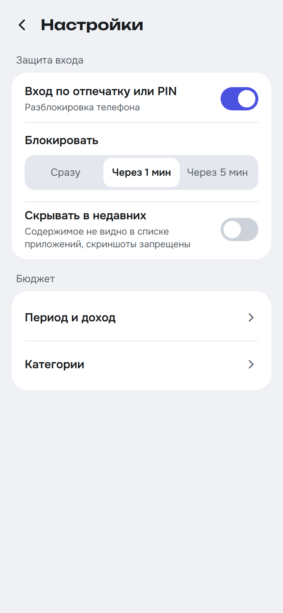
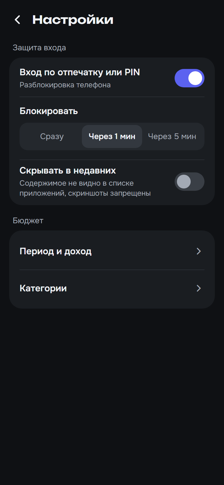

# Макеты BudgetPlanner

Живая версия макетов (просмотр и правки): https://claude.ai/artifact/GSyVfbyh3Y7XNk3RwBPmtx

- `screenshots/` — снимки всех экранов в PNG (390×844, плотность 2×), их можно смотреть прямо на GitHub.
- `mockups/` — копия исходников макетов от 13 октября 2026. Файлы `.dc.html` открываются только в редакторе по ссылке выше, в обычном браузере они не отрисуются. Исходники нужны как источник точных цветов, размеров и текстов при вёрстке на Compose.

Если макеты в редакторе изменятся, снимки и исходники в этой папке устареют, их нужно обновить вместе.

## Экраны

| Экран | Светлая тема | Тёмная тема |
|---|---|---|
| Главный экран |  |  |
| Главный, расхождение с банком |  |  |
| Черновики из уведомлений |  |  |
| Новая трата |  |  |
| Операции |  |  |
| Статистика |  |  |
| Статистика: по дням и сравнение |  |  |
| Статистика: раскрытое «Остальное» |  |  |
| Операции категории из статистики |  |  |
| ИИ-помощник |  |  |
| Онбординг: автоимпорт |  |  |
| Сверка с банком |  |  |
| Онбординг: защита входа |  |  |
| Экран блокировки |  |  |
| Настройки: защита входа |  |  |
| Потеря ключа базы |  |  |

Исходник каждого снимка лежит в `mockups/` под тем же именем с расширением `.dc.html`. Исключение — экраны статистики (`Stats*`, `CategoryOperations`): на этапе add-statistics карточку категорий переделали (список категорий под кольцом, раскрытие «Остального», переход к операциям категории), поэтому старый макет статистики удалён, а снимки сделаны с самого приложения на эмуляторе в том же размере. Запись о статистике в `canvas.json` относится к удалённому макету.

Экраны этапа add-data-protection (`OnboardingProtection`, `LockScreen`, `SettingsProtection`, `KeyLost`) нарисованы отдельно, в редакторе их нет: исходник всех четырёх — обычный HTML `mockups/DataProtection.html`, он открывается в любом браузере. Экран и тема выбираются параметрами, например `DataProtection.html?screen=LockScreen&theme=dark`.

Тёмные варианты и `MainMismatch` не содержат своей вёрстки: они подключают светлый экран с параметром `theme="dark"` или `state="mismatch"`. Палитра обеих тем описана в объекте `THEMES` в начале скрипта каждого экрана, состояние «перерасход» главного экрана задаётся параметром `state="overspend"` в `Main.dc.html`.

`canvas.json` хранит расположение экранов на холсте редактора.
